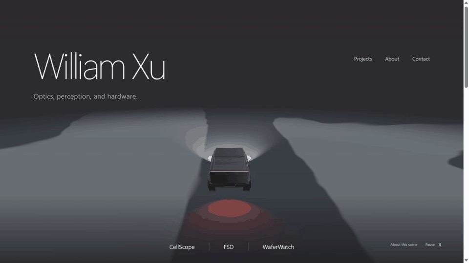
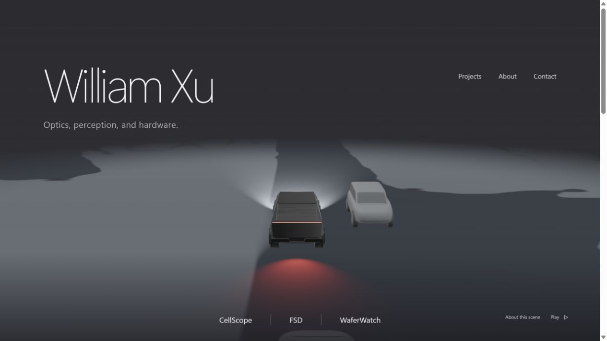
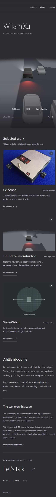

# FSD portfolio experiment

Branch: `test/fsd-portfolio`. This is a reviewable homepage experiment; the workflow
builds an artifact and does not deploy to the production GitHub Pages branch.

## Design

The charcoal reference uses one full-screen recorded FSD scene, restrained name
and navigation, and a quiet index of three projects. Below the opening are the
project notes, a brief introduction, contact links, and scene provenance.

Palette: charcoal `#2d2d31`, ivory `#f2f1f4`, muted text `#bcbcc5`, the original gray
surface classes, and the existing red tail-light illumination. Typography uses
light Segoe UI Variable Display / Helvetica Neue with a simple sans-serif body.

## Preview and verify

```sh
npm ci
npm run dev
npm run lint:experiment
npm run test:scene
npm run build
```

Vite preserves the repository's `/williamxu-portfolio/` deployment base. The preview
also works under that prefix. `?still=1&t=0` holds the source's first frame for
repeatable screenshots. The normal URL plays and loops the clip. Pause/play,
reduced motion, offscreen/hidden-tab suspension, static fallback, keyboard
navigation, and narrow layouts are supported. The original `src/App.jsx` remains
in the branch for comparison; `src/main.jsx` selects the experiment.

## Actual FSD content

- Existing Cybertruck, gray car, and gray person GLBs, unchanged.
- Shared FSD studio environment, headlight setup, and following-camera parameters.
- Forty recorded outputs from scene-0927. The original presentation estimator and
  next-frame registration ran offline; their exact shader-consumed channels were
  packed into two small-dimension RGB atlases.
- The surface shader retains the original road/non-road colors, support-weighted
  belief blending, coverage, and distance fading.
- Only matched actor IDs interpolate. Missing detections remain missing. There is
  no invented road, lane network, scene reconstruction, or live browser inference.
- The approximately 20-second recording restarts at its source boundary; it is
  not an infinitely generated driving simulation.

`public/fsd/ATTRIBUTION.md` carries asset and dataset licenses.
`public/fsd/provenance.json` records the source and output hashes. No source camera
video, model weights, calibration files, ground-truth labels, or private paths are
published in this export.

## Re-export from the research checkout

```sh
node scripts/prepare-fsd-assets.mjs /path/to/fsd
```

This reads the existing prepared scene-0927 recording and FSD filtering modules.
It writes only the allowlisted portfolio assets. It does not start inference or
training. Other source experiments and checkpoints are not selected or promoted.

CellScope imagery comes from William's project presentation. WaferWatch uses a
clearly schematic wafer illustration. Project text is intentionally concise and
omits unresolved performance and commercial claims from the older homepage.

## Browser review

The production build, experiment lint, and three scene tests pass. In-browser
checks confirmed asset loading under the Pages prefix, a loop restart, pause/play,
reduced motion, keyboard-operated project notes, and a narrow layout without
horizontal overflow. Full evidence is in [verification.json](verification.json).

The normal page starts moving automatically after its scene assets load. The
navigation and lower project links now follow the charcoal reference more
closely. A single short intro fade accompanies the existing scene crossfade;
reduced-motion preferences retain a still presentation with an explicit Play
control. The capture below shows approximately five seconds of actual browser
playback, rather than an image-generation animation.






