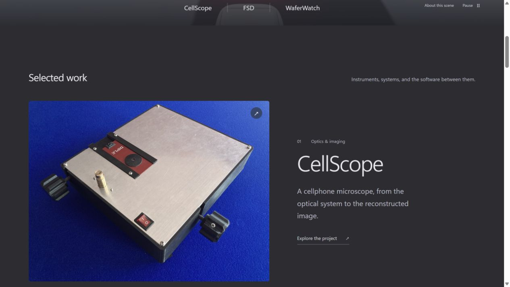
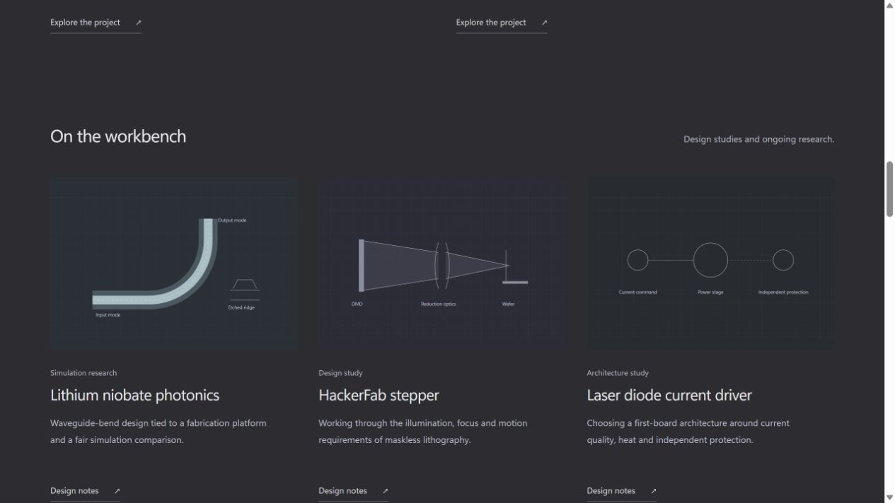

# Portfolio organization

This extends the existing charcoal FSD homepage on `test/fsd-portfolio`. The animation remains the opening reference; the rest of the portfolio gives it engineering context and makes William's other work easy to explore.

## Home page order

1. **Animated introduction.** Existing recorded FSD scene, name, discipline line, Projects / About / Contact navigation.
2. **Selected work.** CellScope is the large opening feature with the physical prototype photograph. WaferWatch and FSD follow as two equally weighted features.
3. **On the workbench.** Lithium niobate photonics, HackerFab stepper and laser diode current driver. Their simulation, design-study and architecture-study stages are visible before opening a page.
4. **Built together.** FRIDAY and HALO. Each page names William's contribution and retains the team context.
5. **More explorations.** A compact index for eight additional tools, interactions and coursework projects. These also open full project pages.
6. **About and experience.** Short motivation, Engineering Science at U of T, McMaster photonics research and CellScope.
7. **Milestones.** Compact recognition list after the work.
8. **Scene context and contact.** FSD playback explanation, credits, direct email and professional links.

## Project pages

Each page has a project summary, personal role, current stage, project-specific visual, starting point, requirements/design decisions, tradeoffs and outcome. An accessible contents list jumps to the relevant section and focuses its heading. Public evidence links appear alongside the writing where available. The next-project link and all-projects navigation preserve a continuous browsing path.

The first-person project text comes from the existing 27 October portfolio-writing document prepared in the main conversation. Its wording, contribution distinctions and version-specific measurements are retained in `src/content/projects.json`. No internal file paths, private reports or application material are published as links.

| Group | Project | Hash route |
| --- | --- | --- |
| Selected | CellScope | `#/projects/cellscope` |
| Selected | WaferWatch | `#/projects/waferwatch` |
| Selected | FSD / camera perception | `#/projects/fsd` |
| Research | Lithium niobate photonics | `#/projects/photonics` |
| Research | HackerFab stepper | `#/projects/hackerfab` |
| Research | Laser diode current driver | `#/projects/laser-driver` |
| Team | FRIDAY | `#/projects/friday` |
| Team | HALO | `#/projects/halo` |
| Index | Jungle | `#/projects/jungle` |
| Index | Wicker | `#/projects/wicker` |
| Index | Looky | `#/projects/looky` |
| Index | Newmux | `#/projects/newmux` |
| Index | Astronomy in the cold | `#/projects/astronomy` |
| Index | The Bifröst | `#/projects/bifrost` |
| Index | A quieter can opening | `#/projects/can-opening` |
| Index | FrameGen | `#/projects/framegen` |

Hash routes support direct project links and refreshes under the existing GitHub Pages base path without server rewrites. Navigating into a case study unmounts and disposes the FSD renderer; the long-form pages do not keep a hidden WebGL scene running.

## Visual treatment

The content inherits the charcoal background, light sans-serif typography and restrained spacing of the approved hero. The hierarchy changes with importance: one large prototype feature, two selected-work features, three research studies, two team builds and a text index. Sixteen identical thumbnail cards would flatten that hierarchy.

Eleven project openings now use 26 images from the original project records, with supporting figures alongside the relevant design decisions. FSD retains its recorded scene. HALO currently shows a clearly labeled implementation excerpt; WaferWatch shows an earlier working prototype. Four smaller projects retain labeled schematics. See [the evidence pass](project-evidence.md) for the complete register, sources and remaining capture gaps.

## Files to continue from

- `src/PortfolioExperiment.jsx`: homepage hierarchy and hash navigation.
- `src/content/projects.json`: all 16 project narratives, roles, stages and evidence links.
- `src/components/ProjectPage.jsx`: shared case-study layout and section navigation.
- `src/components/ProjectArtwork.jsx`: original project media, recorded poster and schematic fallbacks.
- `src/portfolio.css`: shared responsive formatting.
- Existing `src/components/FsdScene.jsx`, `src/scene/` and `public/fsd/`: unchanged scene implementation and recorded outputs.

## Review

Build and scoped lint pass; the three existing recording/asset-integrity tests pass. All 16 project routes were exercised at a 390 px viewport with no horizontal overflow and no retained WebGL canvas. Desktop project navigation, section focus, return-to-home anchors and browser errors were checked. Detailed screenshot metadata is in `organization-verification.json`.

Full-page reviews: [desktop home](organization-home-desktop.png), [mobile home](organization-home-mobile.png), [WaferWatch case study](organization-case-desktop.png), [mobile CellScope case study](organization-case-mobile.png).
