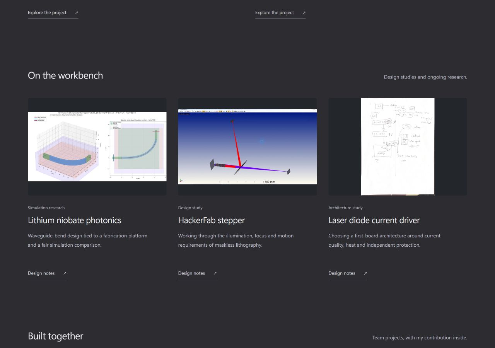
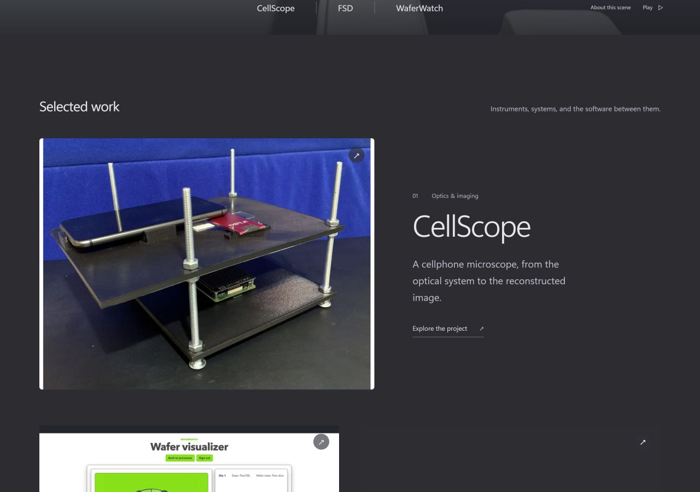

# Original project evidence

This pass replaces the schematic openings for 11 projects with 26 original evidence images and adds figures next to the relevant design decisions. The existing charcoal layout, FSD animation, project order and first-person narratives are retained. Full-resolution image links, descriptive alternative text, source captions and FRIDAY's room-asset license accompany the media.

| Project | Evidence included | Scope |
| --- | --- | --- |
| CellScope | Physical instrument, acquisition setup, resolution comparison, field of view | Original research prototype and experiments |
| WaferWatch | Wafer/die application view | Earlier working prototype |
| FRIDAY | Room editor and sandbox cart/receipt | Team application; licensed room scene; no completed payment |
| HALO | Kotlin model-loader capture from pinned source | Implementation evidence; phone UI capture still missing |
| Photonics | 3D geometry, polygon joins, parameterization and reference reconstruction | Archived geometry studies, not final optical performance |
| HackerFab | Native Zemax paths, objective prescription proxy and spot analysis | Design evaluation, including an unresolved focus result |
| Laser driver | Two original requirements pages | Architecture and control requirements |
| Bifrost | Physical load-test frames, cutting layout and assembly | Team drawings and test footage; predicted load kept separate |
| Jungle | Running approval-queue interface | Recorded application state |
| Looky | STEP and 3MF load-test images | Imported test fixtures in the extended viewer |
| Can opening | Handwritten morphology chart and concept CAD | Team concept exploration |

The existing FSD recording remains in place. Astronomy, Wicker, Newmux and FrameGen retain explicitly labeled explanatory schematics until suitable original media is available.

## Sources and checks

[Public image register and credits](../public/projects/evidence/ATTRIBUTION.md) · [Machine-readable manifest](../public/projects/evidence/manifest.json) · [Verification](evidence-verification.json)

Production build and scoped ESLint pass; the three existing scene tests pass. All 26 images decode with matching dimensions. The 11 changed project routes were checked at 390 CSS pixels with no horizontal overflow, all their images loaded, and no retained WebGL canvas. The homepage was reviewed at 1280 CSS pixels. No browser warnings or errors were captured during this review. The pre-existing Three.js chunk-size warning remains.

## Remaining captures

- WaferWatch's current deployment reports authentication temporarily unavailable; the historical image is labeled accordingly.
- HALO's UI-test APK builds, but a runtime phone capture was not recovered. The source excerpt is explicitly labeled implementation evidence.
- Local iCloud images were reviewed; cloud-only photos remain unavailable while the account is signed out. Local sync is not evidence that the entire iPhone library was searched.

[FRIDAY mobile case study](evidence-friday-mobile.png) · [HALO mobile case study](evidence-halo-mobile.png)
